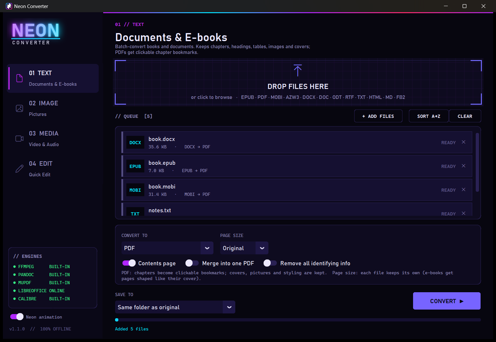
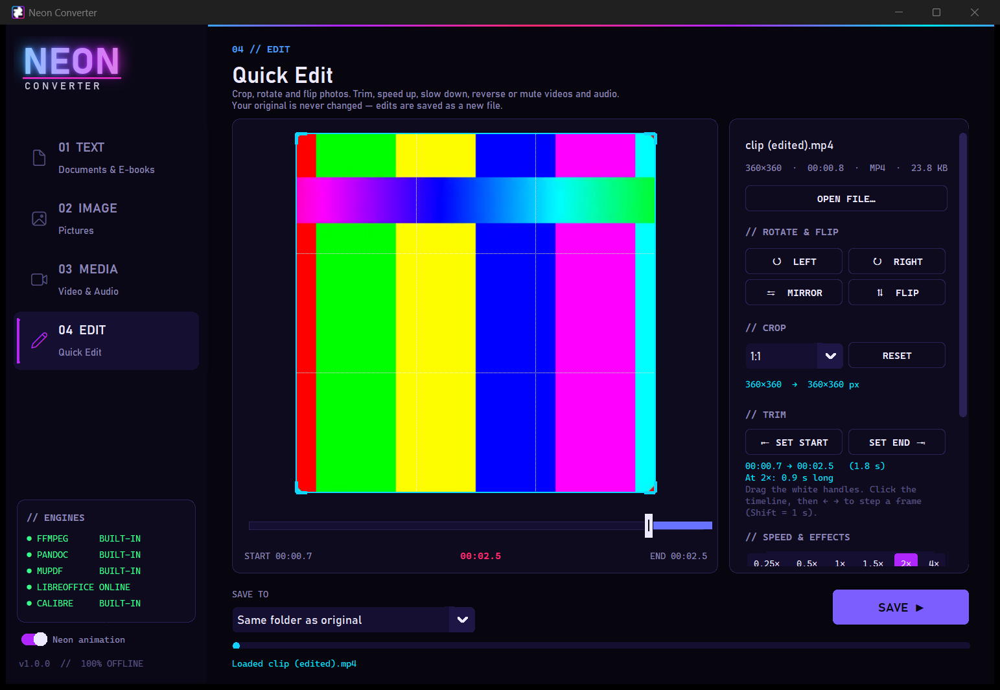

# NEON // CONVERTER

An all-in-one, offline file converter and quick editor for Windows, with a cyberpunk UI whose neon colors
drift between blue, purple and pink. Four modes in one app:

| Mode | What it does |
|---|---|
| **01 // TEXT** — documents & e-books | EPUB · PDF · MOBI · AZW3 · DOCX · DOC · ODT · RTF · TXT · HTML · Markdown · FB2 (+ XPS, CBZ in) |
| **02 // IMAGE** — pictures | PNG · JPG · WEBP · GIF · HEIC · AVIF · TIFF · BMP · ICO · PDF (+ SVG, PSD in; PDF pages → images) |
| **03 // MEDIA** — video & audio | MP4 · MKV · MOV · WEBM · AVI · GIF, **extract audio** to MP3 · M4A · WAV · FLAC · OGG · OPUS, shrink to a size limit |
| **04 // EDIT** — quick edits | crop · rotate · flip photos and videos; trim · speed up / slow down · reverse · mute videos and audio |



## Features

### Documents & e-books
- **Batch conversion** — drop in a whole folder of books and convert them in one go.
- **Structure preservation** — chapters, headings, paragraphs, lists, tables and images are carried across
  wherever the target format can hold them. PDFs are reflowed with structure recovery that rebuilds headings,
  tables and images (using the PDF's own bookmarks as chapter headings when it has them).
- **Covers and pictures are kept** — PDF → EPUB uses the PDF's first page as the book cover (a picture-only
  cover page isn't duplicated in the text); EPUB → PDF starts with the cover; EPUB → Word/ODT/HTML/Markdown/RTF
  keep the cover and every illustration; Kindle formats carry their cover too.
- **Clickable chapter navigation** — PDF output gets bookmarks for every chapter and section, and the
  book's own table-of-contents links keep working. EPUB/HTML output gets a clickable contents page.
- **Formatting** — e-books rendered to PDF keep their styling inside real page margins with page numbers;
  PDF → Word keeps the original layout, fonts, margins and tables.
- **Page size: Original** (default) — Word, ODT and RTF files keep their own page size and margins; e-books,
  which have no fixed pages, get book-shaped pages that match their cover; text/Markdown/HTML use your Windows
  region's paper (Letter or A4). A4, Letter and A5 can still be picked.
- **Merge into one PDF** — convert a stack of documents and join them, with a bookmark per file and each
  file's chapters nested underneath.

### Pictures
- Animated GIF/WEBP stay animated; phone photos stay upright (EXIF rotation); color profiles are kept.
- Quality slider for lossy formats (JPG, WEBP, AVIF, HEIC; 100 = lossless WEBP), resize presets, multi-size
  Windows icons, and **combine many images into one PDF**.

### Video & audio
- Fast "copy" mode re-wraps video without re-encoding when the codecs already fit the new container.
- Quality / resolution presets, palette-optimized GIFs, lossless audio copy to M4A when possible.
- **Size limit** (8 / 10 / 25 / 50 / 100 / 500 MB) — two-pass encoding aimed just under the limit, lowering
  the resolution automatically when needed. Handy for Discord and email.

### Quick edit


- **Crop** by dragging on the picture (free or 1:1, 4:3, 16:9, 9:16 … with rule-of-thirds guides).
- **Rotate and flip** photos and videos.
- **Trim** videos and audio with a timeline — drag the handles, or step frame by frame with ← →.
- **Speed** 0.25× – 4× (audio pitch stays natural), **reverse**, **remove sound**.
- **Save any video frame** as a full-resolution PNG.
- Originals are never touched; edits are saved as `name (edited).ext`.

### Privacy — "Remove all identifying info"
Every mode has this switch. With it on, outputs carry no metadata that points back to you:

| Mode | Removed |
|---|---|
| Pictures & editor | EXIF (GPS, camera make/model/serial numbers, lens, owner, dates, software, hidden thumbnail), XMP/IPTC (creator, location, edit history, document IDs), comments, PNG text, TIFF tags, extra embedded images, and the colour profile (colours are converted to sRGB first) |
| Video & audio | GPS location, device make/model, recording dates, titles/artist/comment tags, chapters, GPS telemetry tracks, encoder version tags |
| Documents | author, editors, company, manager, dates, revision IDs, comment and tracked-change authors, template paths (which contain your Windows user name), printer names, PDF metadata/XMP, and the EXIF/GPS inside photos embedded in documents |

Metadata is all a tool can remove: what a picture shows (faces, places, reflections) or what a text says stays.
`tests/opsec_test.py` plants marker strings in every kind of metadata and checks that none survive.

### Everywhere
- Drag and drop files (or whole folders) — each file is routed to the right mode automatically.
- **Sort A→Z** puts the queue in natural order (Chapter 2 before Chapter 10) — merged PDFs follow it.
- The window reopens at the size and position you left it.
- Right-click any file → **Send to → Neon Converter**.
- Shortcuts: **Ctrl+O** add files · **Ctrl+Enter** convert / save · **Ctrl+1…4** switch mode.
- The taskbar button flashes when a long job finishes while you're in another window.
- **Neon animation** switch; the animation also slows down in the background and stops when minimized.
- Converted files never overwrite originals (`name (1).pdf` …); everything runs locally, nothing is uploaded.

## Download

Grab `NeonConverter-windows.zip` from the [Releases](../../releases) page and unzip it (right-click →
**Extract All** — running it from inside the zip doesn't work). Then either:

- **Install it** — double-click **Install** in the unzipped folder. It copies the app into your user's
  Programs folder, adds Start-menu, Desktop and right-click **Send to** shortcuts, and lists Neon Converter
  under **Settings → Apps**, where you can uninstall it (which also removes its settings and log). No admin
  rights needed, and installing a newer version over an older one keeps your settings.
- **Or run it portable** — just double-click `NeonConverter.exe` in the unzipped folder.

The app isn't code-signed, so the first time Windows may say *"Windows protected your PC"*: click
**More info → Run anyway**. The installer clears Windows' "downloaded from the internet" mark on the
installed copy, so the warning doesn't come back on every launch.

**Everything is built in** — FFmpeg, Pandoc, MuPDF and Calibre's e-book engine (for MOBI/AZW3) ship inside
the app, so there is nothing else to install. Because of that the download is large (≈ 575 MB zipped,
≈ 1.6 GB unpacked). The only optional extra is LibreOffice: if it's installed, the app uses it for legacy
`.doc` files and the most faithful Word → PDF output.

## Run from source

```powershell
git clone https://github.com/resentfuldragon/neon-converter.git
cd neon-converter
python -m venv .venv
.venv\Scripts\python -m pip install -r requirements.txt
.venv\Scripts\python main.py
```

From source, MOBI/AZW3 output needs Calibre: either install it, or point `NEONCONVERTER_CALIBRE` at a
Calibre program folder.

## Build the .exe yourself

```powershell
.venv\Scripts\python -m pip install pyinstaller
.\build.ps1 -Zip          # -> dist\NeonConverter\NeonConverter.exe and dist\NeonConverter-windows.zip
.\install.ps1             # optional: install for this user + shortcuts (-Uninstall removes it)
```

The build puts the same installer into the app folder (`Install.cmd`, which runs `_internal\install.ps1`),
so people who download the zip get it too.

`build.ps1` bundles Calibre automatically: it copies an installed Calibre if you have one, otherwise it
downloads the official Calibre MSI and unpacks it (nothing gets installed). Use `-CalibreDir <folder>` to
pick a specific copy or `-NoCalibre` for a smaller build without MOBI/AZW3 output.

The app icon (`assets/icon.ico`) holds hand-tuned frames from 16 to 256 px so it stays crisp in the
taskbar, title bar and Explorer; regenerate it with `python scripts\make_icon.py` after changing the design.

No build PC? Fork the repo and run the **Build Windows app** workflow from the Actions tab — it builds the
same zip on GitHub's servers (see `.github/workflows/release.yml`).

## Tests

Each script builds its own sample files and prints PASS/FAIL per check:

```powershell
.venv\Scripts\python tests\smoke_test.py    # every converter, every mode
.venv\Scripts\python tests\cover_test.py    # covers and pictures survive PDF <-> EPUB, EPUB -> Word, ...
.venv\Scripts\python tests\edit_test.py     # crop/rotate math, trim, speed, reverse, frames
.venv\Scripts\python tests\extras_test.py   # PDF merge, size limit, metadata stripping, odd file names, cancel
.venv\Scripts\python tests\pages_test.py    # "Original" page sizes for Word/ODT/RTF/e-books/Markdown
.venv\Scripts\python tests\opsec_test.py    # privacy: no planted metadata survives in any output
.venv\Scripts\python tests\perf_check.py    # big queues stay responsive; idle CPU of the animation
```

A built app can test itself too: `NeonConverter.exe --selftest <samples-folder> <output-folder>` writes
`report.txt`.

## How it works

| Engine | Used for |
|---|---|
| [Pandoc](https://pandoc.org) (bundled) | EPUB ⇄ DOCX ⇄ ODT ⇄ HTML ⇄ Markdown ⇄ RTF ⇄ FB2 ⇄ TXT |
| [PyMuPDF](https://pymupdf.readthedocs.io) / [PyMuPDF4LLM](https://github.com/pymupdf/pymupdf4llm) | e-book → PDF with bookmarks, PDF text, PDF reflow (headings, tables, images), PDF merge, SVG/PDF → image |
| [pdf2docx](https://github.com/ArtifexSoftware/pdf2docx) | layout-faithful PDF → Word |
| [KindleUnpack](https://github.com/iscc/mobi) | MOBI/AZW3 input when Calibre isn't available |
| [FFmpeg](https://ffmpeg.org) (bundled) | all video and audio, and the editor |
| [Pillow](https://python-pillow.org) + pillow-heif | images |
| [Calibre](https://calibre-ebook.com) (bundled) | MOBI/AZW3 output, style-preserving e-book ⇄ e-book/PDF/Word |
| LibreOffice (optional) | Word/ODT/RTF → PDF, `.doc` |

Document conversions are planned as the cheapest path through a graph of these engines, so e.g.
PDF → EPUB runs as PDF → Markdown (structure recovery) → EPUB (chapter split + contents page + cover).
Routes never pass *through* plain text or PDF, which would lose structure. The plan for each file is shown
under its name in the queue.

## License

Neon Converter is released under the **GNU AGPL v3** (required because it uses PyMuPDF, which is AGPL).
Bundled tools keep their own licenses — Calibre (GPL v3, shipped unmodified), FFmpeg (GPL), Pandoc (GPL),
KindleUnpack (GPL), pdf2docx (MIT), CustomTkinter, tkinterdnd2, Pillow and others (MIT/BSD).
See [THIRD_PARTY_NOTICES.md](THIRD_PARTY_NOTICES.md) for where to get each one's source code.
